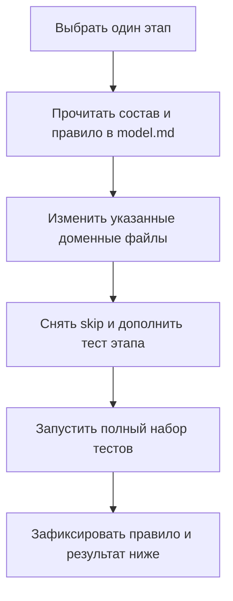

# Карта переноса модели в код

Этот документ превращает итоговую схему из `model.md` в шесть малых изменений
исходного кода. После завершения каждого этапа строка журнала дополняется
ссылкой на изменённый тест и кратким результатом запуска. Следующий этап не
начинается, пока проверки предыдущего остаются пропущенными или красными.



| Этап | Реализовать в домене | Проверить в тесте | Зафиксировать в журнале |
|---|---|---|---|
| 1 | `OrderId`, `OrderLineId`, `BuyerId`, `Sku`, `Currency`, `Quantity`, `Money`, `ShippingAddress`, `OrderLine`, `OrderLineSnapshot`, `Order` и `OrderStatus` | валюта, пустой заказ, адрес, размещение, изменение строки по идентификатору, неизменяемость после `place` | правило полного заказа и список новых типов |
| 2 | `SellerId`, поле продавца в строке и в `Order`, проверку в добавлении строки | отказ второй строки другого продавца без изменения заказа и повторного `OrderLineId` | правило одного продавца и новую сигнатуру строки |
| 3 | `LineKind`, платные и подарочные строки, `add_paid_line`, `add_gift_line` | нулевая цена подарка, платная часть для `place`, снимок строки | две команды и уточнение размещения |
| 4 | `StockItemId`, `WarehouseId`, `StockBalance`, `StockItem`, `receive`, `write_off` | приход, списание, запрет отрицательного остатка | правило физического остатка |
| 5 | `ReservationId`, `OrderId` в резерве, `StockReservation`, `ReservationSummary`, `reserve`, `release_reservation` | доступный остаток, предел резерва, освобождение без удаления | правило активных резервов |
| 6 | `ReservationDeadline`, `ReservationStatus`, `expire_reservations` | истечение в срок, будущий и освобождённый резервы | правило времени и итоговую формулу доступности |

## Рабочая запись этапа

После каждого завершённого этапа заполняется один блок. Формулировка правила
должна быть предметной и проверяемой: например, «активные резервы не превышают
физический остаток», а не «резервирование работает».

```text
Этап:
Изменённые файлы:
Добавленные типы и методы:
Правило, которое защищает корень:
Успешный сценарий:
Негативный сценарий и ожидаемая доменная ошибка:
Сохраняемые проверки:
Результат запуска unittest:
```

## Порядок изменения файлов

На этапах 1–3 сначала меняются `identifiers.py`, `values.py` и `order.py`, затем
активируются `test_order_baseline.py`, `test_order_seller.py` или
`test_order_gifts.py`. На этапах 4–6 сначала меняются типы и `stock_item.py`,
затем активируются `test_stock_baseline.py`, `test_stock_reservations.py` или
`test_stock_expiration.py`. `application.py` и `test_demo.py` становятся
окончательными после этапа 6, когда существуют обе границы и команда `reserve`.

Ни один этап не переносит правило в `application.py`. Прикладной сценарий
создаёт объекты и вызывает команды, но не сравнивает валюты, продавцов, остатки
или статусы вместо корней агрегатов.

---

```text
Этап: 1
Изменённые файлы: domain/errors.py, domain/identifiers.py, domain/values.py,
  domain/order.py, tests/test_order_baseline.py
Добавленные типы и методы: OrderId, OrderLineId, BuyerId, Sku, Currency,
  Quantity, Money, ShippingAddress, OrderLine, OrderLineSnapshot, Order,
  OrderStatus; Order.add_paid_line, change_line_quantity,
  set_shipping_address, place, cancel, total, lines
Правило, которое защищает корень: заказ размещается только при наличии
  строк, полного адреса и положительной суммы; после place состав и адрес
  неизменяемы
Успешный сценарий: строка + адрес → place → PLACED
Негативный сценарий и ожидаемая доменная ошибка: пустой заказ → EmptyOrderError;
  без адреса → IncompleteShippingAddressError; изменение после place →
  OrderNotDraftError
Сохраняемые проверки: валюта, пустой заказ, адрес, размещение, изменение
  строки по идентификатору, неизменяемость после place
Результат запуска unittest: OK

Этап: 2
Изменённые файлы: domain/identifiers.py (SellerId), domain/order.py,
  tests/test_order_seller.py
Добавленные типы и методы: SellerId; поле _seller_id в Order и в OrderLine;
  проверка _ensure_seller_matches; проверка уникальности OrderLineId
Правило, которое защищает корень: все строки заказа принадлежат одному
  продавцу; повторный OrderLineId отклоняется
Успешный сценарий: две строки одного продавца добавляются
Негативный сценарий и ожидаемая доменная ошибка: вторая строка другого
  продавца → SellerMismatchError без изменения заказа; повторный
  OrderLineId → DuplicateOrderLineIdError
Сохраняемые проверки: все проверки этапа 1
Результат запуска unittest: OK

Этап: 3
Изменённые файлы: domain/order.py, tests/test_order_gifts.py
Добавленные типы и методы: LineKind (PAID, GIFT); add_paid_line,
  add_gift_line; снимок OrderLineSnapshot с kind и subtotal
Правило, которое защищает корень: подарок имеет нулевую цену; для place
  нужна хотя бы одна платная строка
Успешный сценарий: платная строка + подарок → place → PLACED
Негативный сценарий и ожидаемая доменная ошибка: заказ только из подарков →
  NoPaidLinesError
Сохраняемые проверки: этапы 1–2
Результат запуска unittest: OK

Этап: 4
Изменённые файлы: domain/values.py (StockBalance), domain/stock_item.py,
  tests/test_stock_baseline.py
Добавленные типы и методы: StockItemId, WarehouseId, StockBalance,
  StockItem.receive, write_off, physical_balance
Правило, которое защищает корень: физический остаток не может стать
  отрицательным
Успешный сценарий: приход 0 → 5; списание 5 → 2
Негативный сценарий и ожидаемая доменная ошибка: списание больше остатка →
  NegativeStockError
Сохраняемые проверки: этапы 1–3
Результат запуска unittest: OK

Этап: 5
Изменённые файлы: domain/identifiers.py (ReservationId), domain/stock_item.py,
  tests/test_stock_reservations.py
Добавленные типы и методы: StockReservation, ReservationSummary,
  ReservationId в резерве, StockItem.reserve, release_reservation,
  available_quantity
Правило, которое защищает корень: сумма активных резервов не превышает
  физический остаток; освобождение не удаляет резерв, а меняет статус
Успешный сценарий: остаток 5, резерв 2 → доступно 3; release → снова 5
Негативный сценарий и ожидаемая доменная ошибка: резерв больше доступного →
  InsufficientStockError
Сохраняемые проверки: этапы 1–4
Результат запуска unittest: OK

Этап: 6
Изменённые файлы: domain/values.py (ReservationDeadline),
  domain/stock_item.py (ReservationStatus, expire_reservations),
  application.py, tests/test_stock_expiration.py, tests/test_demo.py
Добавленные типы и методы: ReservationDeadline, ReservationStatus
  (ACTIVE, RELEASED, EXPIRED), StockItem.expire_reservations(now)
Правило, которое защищает корень: доступный остаток = физический остаток −
  сумма активных резервов; резерв с наступившим сроком переходит в EXPIRED
  и перестаёт уменьшать доступный остаток
Успешный сценарий: два резерва (прошлый и будущий) + освобождённый →
  expire_reservations(now) возвращает 1, доступно 7
Негативный сценарий и ожидаемая доменная ошибка: повторное освобождение или
  истечение уже неактивного резерва → ReservationNotActiveError (для
  release); expire_reservations возвращает 0 и не меняет статус
Сохраняемые проверки: этапы 1–5
Результат запуска unittest: OK
```